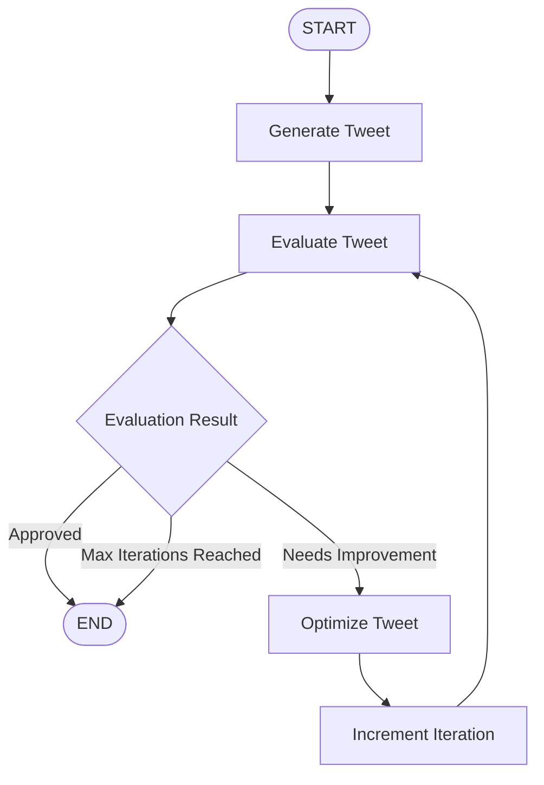

# 🐦 LangGraph Iterative Workflow – Twitter Post Generator

An LLM-powered Twitter/X post generation system built using **LangGraph** and **Hugging Face models**. This project uses an iterative workflow where an LLM generates a tweet, another LLM evaluates its quality, and an optimizer improves it based on the evaluation feedback.

The process repeats until the tweet is approved or the maximum iteration limit is reached.

## 🚀 Project Overview

The application generates engaging and humorous Twitter/X posts based on a user-provided topic.

Unlike a simple LLM-based generation system, this project follows an iterative approach:

1. **Generate:** Create an initial tweet based on the given topic.
2. **Evaluate:** Evaluate the tweet based on humor, originality, punchiness, relatability, and character limit.
3. **Optimize:** Improve the tweet using the evaluator's feedback.
4. **Repeat:** Send the improved tweet back for evaluation.
5. **Stop:** End the workflow when the tweet is approved or the maximum number of iterations is reached.

## 🏗️ Workflow Architecture



## 🧩 Workflow Components

| Component | Responsibility |
|---|---|
| Generate Tweet | Generates an initial tweet based on the given topic. |
| Evaluate Tweet | Evaluates the tweet and provides improvement feedback. |
| Optimize Tweet | Rewrites the tweet using the evaluation feedback. |
| Conditional Router | Decides whether to approve the tweet, optimize it, or stop. |

## 🔄 Iterative Workflow Logic

The workflow follows a feedback loop:

**Generate → Evaluate → Optimize → Evaluate → Repeat**

- If the evaluation result is `approved`, the workflow terminates.
- If the evaluation result is `needs_improvement`, the tweet is sent to the optimizer.
- The iteration counter is incremented after every optimization.
- If the maximum iteration limit is reached, the workflow terminates.

## 🤖 Hugging Face Models

This project uses locally hosted Hugging Face instruction-tuned models.

| Model | Purpose |
|---|---|
| Qwen/Qwen2.5-0.5B-Instruct | Tweet generation and evaluation |
| TinyLlama/TinyLlama-1.1B-Chat-v1.0 | Additional evaluator model configuration |
| HuggingFaceTB/SmolLM2-1.7B-Instruct | Tweet optimization |

*Note: The model used for evaluation depends on the active model configuration in the implementation.*

## 🛠️ Technologies Used

- Python
- LangGraph
- LangChain
- Hugging Face Transformers
- HuggingFacePipeline
- ChatHuggingFace
- Pydantic
- TypedDict
- Local LLM Inference

## 📂 Project Structure

```text
LangGraph_Iterative-workflow_Twitter-Post-Generator/
│
├── iterative_workflow.ipynb
├── README.md
└── .gitignore
```

## ⚙️ Installation and Setup

### 1. Clone the Repository

```bash
git clone https://github.com/shivanivemula17/LangGraph_Iterative-workflow_Twitter-Post-Generator.git
```

### 2. Navigate to the Project Directory

```bash
cd LangGraph_Iterative-workflow_Twitter-Post-Generator
```

### 3. Install Dependencies

```bash
pip install langgraph langchain langchain-core langchain-huggingface transformers torch pydantic python-dotenv
```

### 4. Run the Notebook

Open `iterative_workflow.ipynb` using Jupyter Notebook or VS Code and execute the cells.

**Note:** The models are downloaded from Hugging Face when first loaded. Local inference requires sufficient RAM and processing resources.

## 💡 Example

**Input Topic:**

```text
Indian Railways
```

**Workflow Execution:**

```text
Iteration 1:
    Generate Tweet
        ↓
    Evaluate Tweet
        ↓
    Needs Improvement
        ↓
    Optimize Tweet

Iteration 2:
    Evaluate Improved Tweet
        ↓
    Approved
        ↓
       END
```

**Final Output:**

The workflow returns the final tweet along with its evaluation result, feedback, and iteration count.

## 🎯 Key LangGraph Concepts Demonstrated

- StateGraph
- TypedDict for workflow state management
- Nodes and Edges
- START and END
- Conditional Edges
- LLM-based Evaluation
- Feedback-driven Optimization
- Iterative Workflows
- Looping and Termination Conditions
- Multi-LLM Integration

---

⭐ **Learning LangGraph through practical LLM-based workflow development.**
