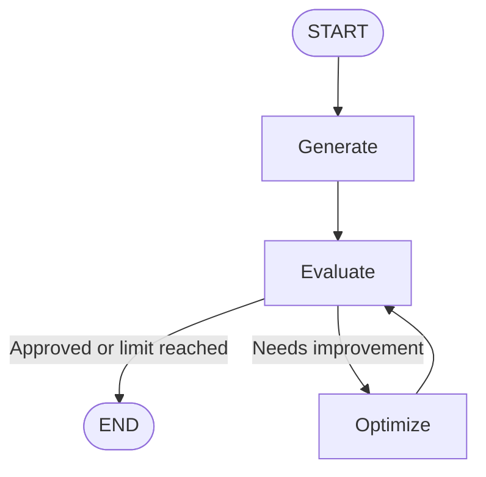

# Twitter (X) Post Generator: Iterative LangGraph Workflow

A learning project that uses **LangGraph** to generate, evaluate and rewrite tweets in a loop. It runs open-source Hugging Face models on your own computer. It creates draft text only and does not post to X.

## How It Works

1. **Generate:** writes a tweet about your topic.
2. **Evaluate:** reviews the tweet and gives feedback.
3. **Optimize:** rewrites the tweet using that feedback.

The workflow stops when the tweet is approved or the iteration limit is reached.



## Models

| Role | Model |
|---|---|
| Generator | `Qwen/Qwen2.5-0.5B-Instruct` |
| Evaluator | `TinyLlama/TinyLlama-1.1B-Chat-v1.0` |
| Optimizer | `HuggingFaceTB/SmolLM2-1.7B-Instruct` |

## State

| Field | Description |
|---|---|
| `topic` | Subject of the tweet |
| `tweet` | Latest draft |
| `evaluation` | `approved` or `needs_improvement` |
| `feedback` | Latest evaluator reply |
| `iteration` | Current iteration number |
| `max_iteration` | Iteration limit |
| `tweet_history` | All drafts |
| `feedback_history` | All evaluator replies |

The two history fields use `operator.add`, so new entries are added instead of replacing old ones.

## Tech Stack

- Python (developed with 3.12)
- LangGraph
- LangChain and `langchain-huggingface`
- Hugging Face Transformers and PyTorch
- Jupyter Notebook

## Setup

1. Install the dependencies:

   ```bash
   pip install langgraph langchain-core langchain-huggingface transformers torch pydantic python-dotenv ipykernel
   ```

2. Open `Twitter(X)_Post_Generator.ipynb` in VS Code or Jupyter.

3. Run all cells in order.

The models download on the first run, so you need an internet connection and enough disk space. All three are loaded into memory together.

These models are public, so a Hugging Face token should not be required. If you use one, add it to a `.env` file as shown below, and do not commit that file.

```env
HF_TOKEN=your_token_here
```

## Usage

Set your topic and iteration limit in the last cell:

```python
initial_state = {
    "topic": "Indian Railways",
    "iteration": 1,
    "max_iteration": 2
}

for step in workflow.stream(initial_state, stream_mode="updates"):
    print(step, flush=True)
```

Each step's updates are printed when it finishes. A limit of `2` allows up to two evaluations and one rewrite.

## Limitations

- The small models may ignore instructions, for example by using question-answer format or adding text in another language.
- Evaluator feedback may be inaccurate or cut off at the 150-token limit.
- Approval requires the evaluator to follow a specific first-line format. Otherwise, the result defaults to `needs_improvement`.
- The optimizer may return the same tweet without changes.
- The final tweet may be unapproved or longer than 280 characters if the workflow reaches its limit.
- Running the models on a CPU may be slow.

## Future Improvements

- Check tweet length and language rules in Python.
- Make the evaluator's reply format more reliable.
- Enable sampling for more varied drafts.
- Try stronger models.
- Add a simple user interface.